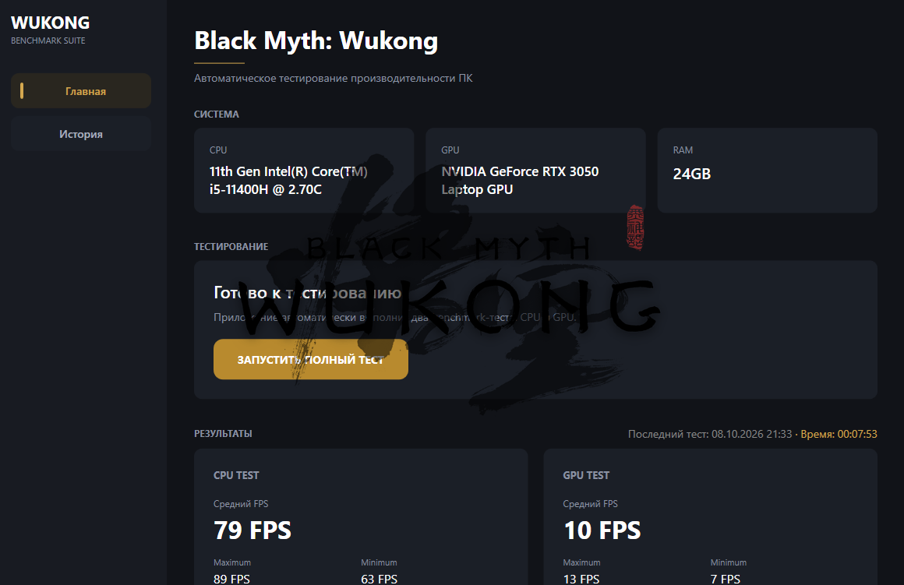
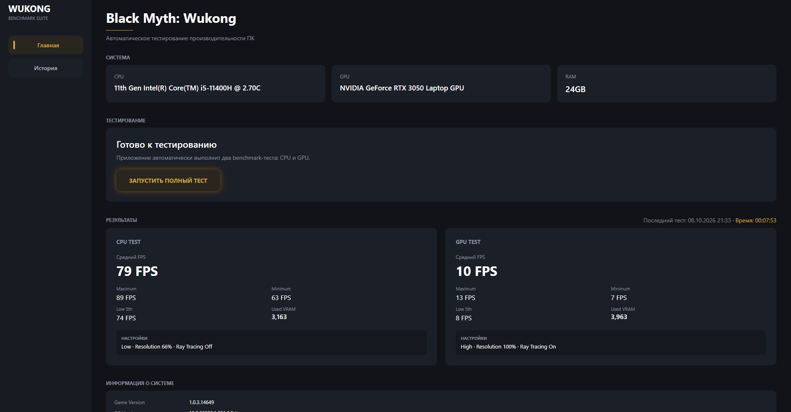
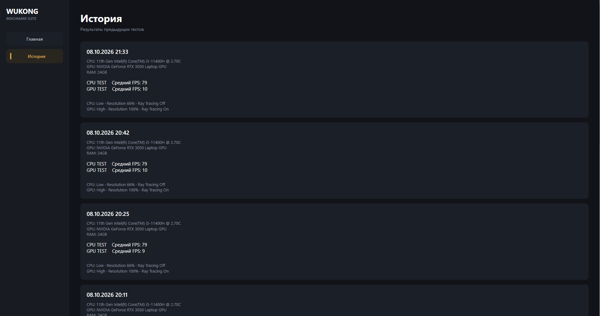

# Wukong Benchmark для VK MidSprint

Десктоп-приложение на **C# / WPF**, которое автоматизирует тестирование производительности компьютера с помощью **Black Myth: Wukong Benchmark Tool**.
Приложение самостоятельно запускает два тестовых сценария — **CPU Test** + **GPU Test**, изменяет настройки Benchmark Tool, дожидается завершения тестирования, получает скрин с результатами и распознаёт данные с помощью **OCR**.

Полученные результаты отображаются в удобном интерфейсе приложения и сохраняются в истории тестов.

---

## Инструкция

После нажатия **«ЗАПУСТИТЬ ПОЛНЫЙ ТЕСТ»** приложение выполняет последовательность действий автоматически (между запусками необходимо подтвердить запуск утилиты из стим с пользовательским конфигом)
P.S. Из-за моего слабого компьютера дилей между запусками значительно увеличен и длительность общего теста = 8 минут, на более сильной сборке скорость значительно больше =)
### 1. CPU Test

Перед первым тестом приложение изменяет конфигурацию Benchmark Tool:

* Resolution Quality — **66%**;
* графические настройки — минимальные;
* Ray Tracing — **Off**;
* уменьшается графическая нагрузка.

Цель сценария — **минимизировать влияние GPU и сделать CPU основным ограничивающим фактором**.
После этого Benchmark Tool запускается автоматически, тест выполняется, а после завершения приложение получает screenshot с результатами.

### 2. GPU Test

После завершения CPU Test Benchmark Tool закрывается.

Затем приложение автоматически изменяет конфигурацию для GPU-ориентированного сценария:

* Resolution Quality — **100%**;
* графические настройки — **High**;
* Ray Tracing — **On**.

После завершения теста приложение снова получает скриншот и распознаёт результаты.

### 3. Обработка результатов

Полученные скриншоты обрабатываются с помощью OCR.
Мной выбраны параметры:

* Average FPS;
* Maximum FPS;
* Minimum FPS;
* Low 5th FPS;
* Used VRAM;
* VRAM;
* RAM;
* CPU;
* GPU;
* GPU Driver;
* Game Version;
* Operating System Version;
* Frame Generation;
* Графический пресет.

После обработки данные передаются в интерфейс приложения и сохраняются в историю.

---

## История тестов

Каждый завершённый тест сохраняется в истории.

Для каждого запуска сохраняются:

* дата и время;
* продолжительность тестирования;
* CPU и GPU;
* RAM и VRAM;
* системная информация;
* CPU Test результаты;
* GPU Test результаты;
* настройки обоих сценариев.

История сохраняется между запусками приложения, поэтому предыдущие результаты не теряются после закрытия программы.

---

## 🛠️ Технологии

### Основной стек

* **C#**
* **.NET 8**
* **WPF**
* **XAML**

### Автоматизация

* **FlaUI**
* Windows API (`user32.dll`)
* управление процессами Windows
* автоматическое управление мышью и окнами

### OCR

* **Tesseract OCR**
* `Tesseract.Drawing`

### Работа с системой

* `System.Management`
* `System.Diagnostics`
* `System.Drawing.Common`

### Хранение данных

* JSON-based история результатов

---

## 🚀 Запуск проекта

### Требования

* Windows 10/11
* .NET 8 SDK
* установленный **Black Myth: Wukong Benchmark Tool**
* доступ к файлам конфигурации Benchmark Tool

### Запуск

1. Клонировать репозиторий.
2. Открыть проект в Visual Studio.
3. Проверить путь к `b1_benchmark.exe` в `BenchmarkToolService.cs`.
4. Убедиться, что Benchmark Tool установлен.
5. Собрать проект.
6. Запустить приложение.

После запуска достаточно нажать:

**«ЗАПУСТИТЬ ПОЛНЫЙ ТЕСТ»**

Выполнение происходит автоматически.

---

## ⚠️ Особенности и ограничения

Автоматизация Benchmark Tool выполняется с использованием Windows API и координат интерфейса приложения.

Поэтому корректность автоматизации зависит от:

* разрешения экрана;
* положения окна Benchmark Tool;
* интерфейса и версии Benchmark Tool;
* доступности файлов конфигурации.

При разработке использовалось разрешение **1920х1080**.

---

## Screenshots

### Главная страница

### Результаты CPU и GPU тестов

### История тестов

---

## Автор

**cutierin**

GitHub: https://github.com/cutierinqa 
